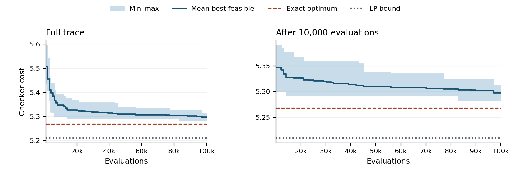

### 01   /   Penalty experiment
# How the capacity penalty affects VM placement
**Kabdulla Danial · GA-P**   |   T12, cloud B2, instance seed 12   |   GA-A partner Zere Zhussupbekova

## Prediction before final runs
Raising the penalty from 1 to 100 should produce more feasible offspring, while the final feasible cost may change little. Stronger selection against overload makes overloaded parents less likely to reproduce. The instance needs 172 of 454 CPU units and 615 of 1,680 memory units in total. Even at a light penalty, the search has room to find feasible placements, although individual servers can still fill up.

## What the penalty measures
An individual assigns each of the 35 VMs to one of 10 servers. Uniform crossover inherits each VM’s server from one parent. Mutation moves one or two VMs. Both operations preserve required zones and allow CPU or memory overload.

For each server, add the positive excess above 1 in the CPU load-to-capacity ratio and the memory load-to-capacity ratio. Sum these excesses to obtain V. A server using 6 of 4 CPU units and 10 of 8 memory units contributes 0.50 + 0.25 = 0.75. Tournament selection minimizes **checker cost + ρ × V**. Final costs below are the checker’s costs for feasible placements.

## Five paired tuning seeds per weight
| Penalty ρ | Feasible offspring | Mean final cost | Runs ending infeasible |
| --- | --- | --- | --- |
| 1 | 74.92% | 5.296684 | 0 / 5 |
| 10 | 82.07% | 5.301752 | 0 / 5 |
| 100 | 87.12% | 5.310238 | 0 / 5 |
_Seeds 100–104. Each row pools 499,850 offspring from five runs. Each run spent 100,000 evaluations, including an initial population of 30. The mean cost uses the five feasible final solutions._

Raising ρ from 1 to 100 increased the feasible share by **12.20 percentage points**. The mean cost rose by 0.013554, about 0.26%. This matches the prediction on average. The feasible share increased on four of five seeds. Seed 100 was the exception, slipping from 85.04% to 84.97%.

All weights tied on final feasibility. The predeclared second criterion was the lowest mean feasible cost, so **ρ = 1** was fixed before the ten final seeds. The best individual tuning run came from ρ = 10 (5.272958), which shows why choosing from a single seed would have produced a different setting.

---
### 02   /   Final runs
# Genetic search and random search
Both methods used seeds 0–9 and exactly 100,000 checker evaluations per seed. The GA used 30 individuals, a two-way tournament, one elite, crossover probability 0.9 and ρ = 1. Random search sampled assignments from the same zone-respecting initializer.

## Table 1. Final feasible cost and gaps
| Statistic | GA cost | GA gaps (%) ref / LP | Random cost | Random gaps (%) ref / LP |
| --- | --- | --- | --- | --- |
| Best | 5.282228 | 0.264 / 1.373 | 5.549270 | 5.333 / 6.119 |
| Median | 5.302025 | 0.640 / 1.741 | 5.622094 | 6.715 / 7.335 |
| Mean | 5.297992 | 0.563 / 1.667 | 5.623761 | 6.747 / 7.363 |
| Worst | 5.312343 | 0.836 / 1.932 | 5.717093 | 8.518 / 8.875 |
Both methods returned **10/10 feasible** placements. Sample standard deviation was 0.009793 for GA and 0.051770 for random search. Mean elapsed time was 12.16 s and 14.39 s per run, respectively, in the published GA-A results.

## Figure F1. Best feasible cost against evaluations

_Each point uses all ten GA seeds, starting at evaluation 1,001. Shading spans the best and worst incumbents. The dashed line is the exact optimum (5.268322). The dotted line is the LP lower bound (5.209695)._

The mean fell from 5.506438 at evaluation 1,001 to 5.310149 at 50,001 and 5.297992 at 100,000. The last improvement across the ten runs occurred at evaluation 96,137. The mean continued to improve late in the budget. The best and worst final GA placements differed by 0.030114, despite identical parameters.

---
### 03   /   Worst-seed diagnosis
# What limited the worst run?
Seed **5** returned the largest feasible GA cost, 5.312343, 0.010318 above the median. Its last 58,886 evaluations produced no lower feasible cost.

## Table 2. Checks on the worst feasible run
| Check | Observation |
| --- | --- |
| Worst feasible GA seed | 5 |
| Final checker cost | 5.312342657 |
| Last strict improvement | Evaluation 41,114 / 100,000 |
| Improving transfers | 1 of 216 feasible |
| Improving swaps | 7 of 358 feasible |
| Distinct assignments in initial population | 30 / 30 |
| Distinct assignments in final generation | 8 / 8 |
_Transfers examined all 315 changes of server. Swaps examined 538 unordered VM pairs on different servers. Both counts require a feasible checker result and strictly lower checker cost._

## Neighbourhood and population
Moving VM 32 from server 8 to server 6 gives a feasible cost of 5.303072, a gain of 0.009271. Swapping VMs 5 and 32 on servers 9 and 8 gives a feasible cost of 5.300219, a gain of 0.012123. Both neighbourhoods offered an improving move at the end of the run. The GA stopped short of a local optimum in each. VM and server indices start at zero.

The first population of children and its elite contained 30 distinct assignments out of 30. The last full population contained 30/30. Only 7 further offspring fit in the remaining budget, so the last generation comprised those offspring and one elite. Every individual in those sampled populations was distinct. A population of identical assignments cannot explain this plateau.

## What the comparison establishes
The GA beat random search on 10 out of 10 matched seeds. Its mean cost was 0.325770 lower. Its mean gap to the exact optimum was 0.563%, compared with 6.747% for random search. The GA’s mean gap to the LP bound was 1.667%. Even the exact integer optimum is 1.113% above that bound under the course’s LP-gap formula.

_The pair runs are in results/Zhussupbekova_runs.csv. The penalty sweep, saved GA traces and move counts are in results/kabdulla_exp.csv, results/kabdulla_ga_details.json and results/kabdulla_analysis.json._
