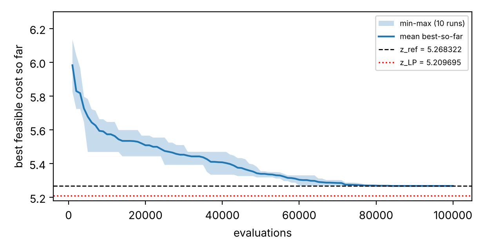
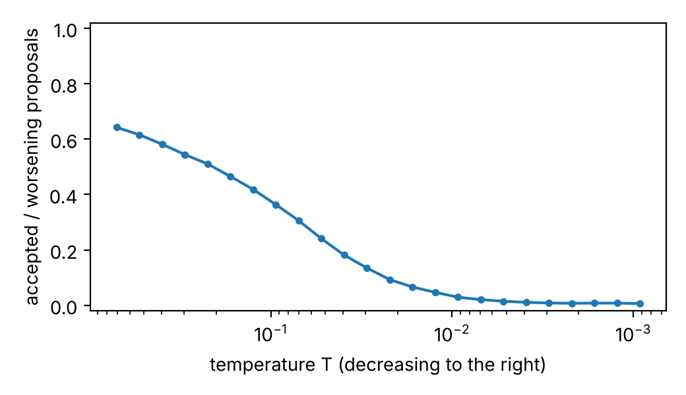

# Checkpoint 4 — Tilesbay Yermukhamed (SA-I), team T12

Storyline B (cloud), variant B2 (zones), instance `cp34_instance(12, 'B', 2)`; simulated annealing with transfer and swap; budget 100,000 evaluations; seeds 0–9. Data: `results/tilesbay_runs.csv`, `results/tilesbay_analysis.json`. Partner: Aitzhanov Tamerlan (SA-T).

## 1. Prediction (written before the final runs; `results/prediction_SA-I.txt`)

The fill ratio is low: CPU 172/454 = 0.38 and memory 615/1,680 = 0.37. Capacities should rarely bind; only the 12 VMs with a required zone restrict the moves. I predicted 10 of 10 feasible runs, a mean gap_ref between 0 and 1%, and that the limit would be the integer granularity of the CPU requests on small servers and the final temperature, not the budget.

## 2. Method

Moves: transfer (70%) and swap (30%). A move that breaks a zone rule is never generated. A move that overloads CPU or memory is evaluated (one evaluation) and rejected, so the current state is always feasible. Cooling is geometric over K = 99,999 proposals. The temperatures of Table 1 are the ones tuned by SA-T with Nelder–Mead on the seeds 100–104: T0 = 0.820689, Tend = 0.000795. On those seeds they beat the rule-based start (mean cost 5.268322 against 5.269467), so by the rule of the protocol they are used for the final runs. For comparison I also ran the rule of the course (a random walk of 3,000 proposals charged to the budget, T0 = 4.5 × median(Δ > 0), Tend = 0.22 × 5th percentile(Δ > 0); for seed 0: T0 = 0.851, Tend = 0.0022) on the same seeds 0–9 (`results/tilesbay_runs_rule.csv`).

## 3. Table 1 and Figure F1

**Table 1. SA final feasible cost, 10 runs (seeds 0–9), tuned T0 and Tend**

| | best | median | mean | worst | std (n−1) | feasible | time/run |
| --- | --- | --- | --- | --- | --- | --- | --- |
| cost | 5.268322 | 5.268322 | 5.268322 | 5.268322 | 0 | 10/10 | 0.22 s |
| gap_ref % | 0.000002 | 0.000002 | 0.000002 | 0.000002 | | | |
| gap_LP % | 1.1128 | 1.1128 | 1.1128 | 1.1128 | | | |

gap_ref = 1.6·10⁻⁶ % appears only because z_ref is given with 6 decimals: all ten runs end at the cost of z_ref. With the rule-based temperatures the ten runs also all end at 5.268322 (mean time 0.33 s), so at the full budget tuning makes no difference to the cost.

**Random-search baseline** (owner: SA-T, same budget 100,000 and seeds 0–9, `results/Aitzhanov_tuning.csv`):

| | best | median | mean | worst | std | feasible |
| --- | --- | --- | --- | --- | --- | --- |
| cost | 5.532876 | 5.613586 | 5.617836 | 5.689910 | 0.048988 | 10/10 |
| gap_ref % | 5.022 | 6.554 | 6.634 | 8.002 | | |
| gap_LP % | 5.841 | 7.195 | 7.265 | 8.440 | | |

_Figure F1. Best feasible cost so far against evaluations: mean of the ten SA runs with the min–max band. The dashed line is z_ref = 5.268322, the dotted line is z_LP = 5.209695._

## 4. The six questions

**1. Is the answer feasible?** All 10 runs are feasible, so there is no infeasible solution to measure. About 7.5% of the worsening candidates were rejected for capacity (10.5% in the first 5% of the proposals, 6.9% in the last 5%, worst seed). Capacity is touched but never blocks the search.

**2. Is it repeatable?** Best = median = worst = 5.268322, standard deviation 0. The ten final assignments are all different (10 distinct) but have the same cost: the latency is piecewise linear, so many assignments lie on a plateau of equal cost. A spread appears only with a smaller budget and the rule-based temperatures: for 30,000 evaluations (`results/tilesbay_budget30000_rule.csv`) 5 of 10 runs reach z_ref, the mean gap_ref is 0.031% and the worst 0.090%. With the tuned temperatures (`results/tilesbay_budget30000.csv`) all 10 runs reach z_ref even with 30,000 evaluations.

**3. Did it converge?** Every curve reaches its final value between 64,000 and 77,000 evaluations (median 67,000, i.e. 67% of the budget; the latest at 77%). After that it is flat for at least 23% of the budget, so it is not still falling at the end. The budget is large enough for both temperature settings at 100,000.

**4. Local optimum of which neighbourhood?** Worst seed (all seeds tie; I name seed 0): from its final solution there are 0 improving transfers and 0 improving swaps (all 35 × 9 = 315 transfers and all swaps tried, the checker as judge). It is a local optimum of both neighbourhoods; since its cost equals z_ref it is also a global optimum.

**5. What did the method do?** Seed 0: 63.6% of the worsening proposals were accepted in the first 5% (1,854 of 2,916) and 0.33% in the last 5% (16 of 4,847). The run starts hot (almost a random walk) and ends frozen; the optimum is first reached at T ≈ 0.0097, after about 64,000 evaluations.

**6. Better than random search? How far from the bound?** Yes. Random search with the same budget and seeds ends at a mean cost of 5.617836 (gap_ref 6.634%, gap_LP 7.265%), and even its best run (5.532876) is worse than every SA run (5.268322); SA is better by about 6.2% in cost. The gap_LP of SA (1.113%) equals the gap of the relaxation itself, 100 × (z_ref − z_LP) / z_ref = 1.113%: nothing more can be won, and the remaining distance to z_LP is the integrality gap.

## 5. Table 2 (worst seed) and explanation

**Table 2. Checks on the worst feasible run**

| seed | final cost | improving transfers | improving swaps | accepted worsening, first 5% | accepted worsening, last 5% |
| --- | --- | --- | --- | --- | --- |
| 0 | 5.268322 | 0 (of 215 feasible) | 0 (of 357 feasible) | 63.6% (1,854 / 2,916) | 0.33% (16 / 4,847) |

_Transfers examined all 315 changes of server; swaps examined 537 unordered VM pairs on different servers. A move counts if the checker accepts it and its cost is strictly lower._

The "worst" run is not worse than the others: all ten ended at 5.268322. It stopped on a solution where no single transfer or swap lowers the cost; neighbours of equal cost (Δ = 0) are not improving by the strict definition. No move would leave this point downhill, so the explanation is that the run found the optimum.

## 6. Prediction against result

Right: 10 of 10 feasible and the mean gap_ref in [0, 1]% (it is ≈ 0). Not right in the details: I expected the integer granularity or the final temperature to be the limit, but nothing limited the 100,000-evaluation run with either setting. The visible limit is the cooling schedule at a smaller budget: with 30,000 evaluations the rule-based temperatures leave 5 of 10 runs above z_ref and the tuned ones reach z_ref in all 10. I also expected capacity rejections to be rare; they were about 7.5%.

## 7. Role item: acceptance share of worsening moves against temperature

_Share of accepted worsening proposals against T, ten seeds pooled. Temperature decreases to the right._

The share falls from about 0.64 at T0 to about 0.01 at Tend. It is below 0.1 for T < 0.02, and the optimum of seed 0 appears at T ≈ 0.0097, where the share is about 0.03.

_Files: tuned final runs in `results/tilesbay_runs.csv`; rule-based comparison in `results/tilesbay_runs_rule.csv`; extra budget checks in `results/tilesbay_budget30000.csv` and `results/tilesbay_budget30000_rule.csv`; analysis in `results/tilesbay_analysis.json`; figures `results/F1_SA-I.png` and `results/accept_vs_T_SA-I.png`. Commands to reproduce are in the README._
